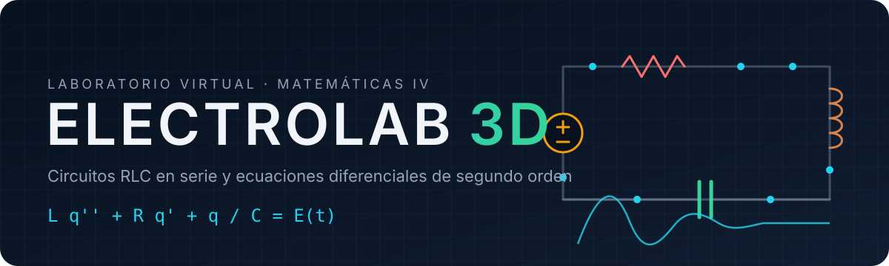
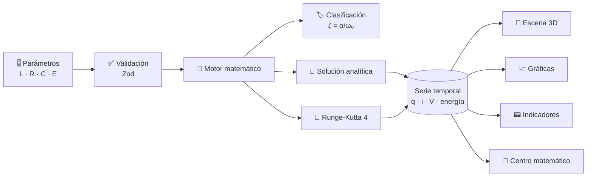
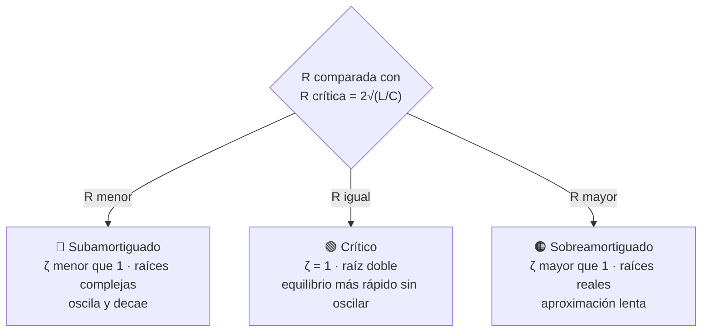
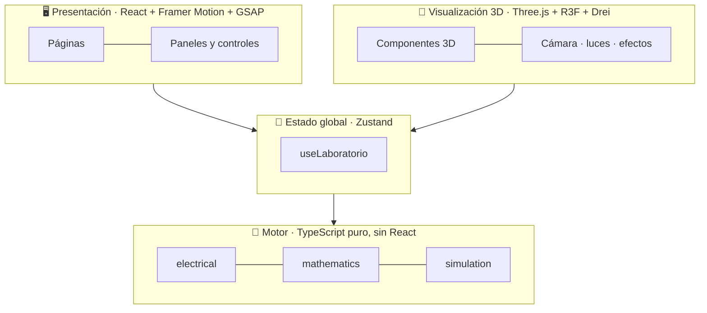

<p align="center">
  
</p>

<p align="center">
  <a href="https://electrolab3d.vercel.app"></a>
  
  
  
  
</p>

<p align="center">
  <b>Laboratorio virtual 3D para experimentar con circuitos RLC en serie<br/>y ver cómo una ecuación diferencial de segundo orden describe su comportamiento.</b>
</p>

---

## 👥 Equipo

| Bloque | Integrante | Capítulo de la presentación |
|:-:|---|---|
| I | **Alejandro Piedrahita** | El circuito y sus componentes |
| II | **Daniel Colorado** | Del circuito a la ecuación diferencial |
| III | **Sebastián Patiño** | Comportamiento, resultados y aplicaciones |

**Proyecto final de Matemáticas IV** · Profesor **Cristian C. Sánchez**
Ingeniería de Sistemas y Telecomunicaciones · Octavo semestre

---

## ✨ Qué incluye

| | Módulo | Qué puedes hacer |
|:-:|---|---|
| 🏠 | **Inicio** | Portada con el circuito 3D funcionando en vivo e indicadores |
| 🧩 | **Estación de ensamblaje** | Protoboard 3D: arrastra fuente, R, L, C, interruptor y cables; la topología se analiza (cortos, terminales abiertos, paralelos) y el lazo válido se simula |
| 🔬 | **Laboratorio 3D** | Rotar, hacer zoom, seleccionar componentes, ver **rayos X** y **despiece interno**, encender, pausar y cambiar la velocidad |
| 🎬 | **Presentación** | 23 diapositivas en tres capítulos (uno por integrante): despieces, osciladores mecánicos movidos por q(t) real, comparación de regímenes y aplicaciones 3D (suspensión, instrumento de aguja, cierrapuertas, sintonizador) |
| 📐 | **Centro matemático** | Resolución animada en 13 pasos (reproducir, pausar, paso a paso, velocidad) mientras la gráfica q(t) se dibuja; vista de documento completo |
| 📈 | **Gráficas** | q(t), i(t), voltajes, energía, comparación de los 3 regímenes, error de RK4 y exportación CSV |
| 🧪 | **Experimentos** | 5 experimentos guiados con barridos de R, C, L y fuente; historial guardado |
| 🏆 | **Desafíos** | *Predice antes de experimentar* + cuestionario con puntaje generado por el motor |
| 📚 | **Aplicaciones** | Usos reales, analogía mecánica, formulario, glosario, unidades y referencias |

🌗 **Modo claro y oscuro** en toda la aplicación · 📱 **Diseño responsive pensado primero para celular** · 🔎 **Fórmulas interactivas**: toca cualquier variable (L, R, C, q, α, ω₀, ζ…) para ver su significado y unidad

---

## 🧠 La idea central: todo sale de la ecuación

$$L\,q''(t) + R\,q'(t) + \frac{1}{C}\,q(t) = E(t)$$

Un solo resultado de simulación alimenta **todo** lo que se ve. Mover un slider cambia a la vez los cálculos, la clasificación, las gráficas y la animación 3D.



### Cómo la escena 3D refleja el motor

| Componente 3D | Qué lo controla | Por dentro (despiece) |
|---|---|---|
| ⚡ Portadores en el cable | velocidad y sentido ∝ **i(t)** | — |
| 🔋 Fuente | indicador y LED = **E(t)** | carcasa, cátodo MnO₂, separador, ánodo de zinc |
| 🟫 Resistor | brillo térmico ∝ **P = R·i²**; bandas = valor real de R | recubrimiento, película de carbón en espiral, núcleo cerámico |
| 🌀 Inductor | campo magnético ∝ **\|i(t)\|**; espiras según L | devanado de cobre, núcleo de ferrita, carrete |
| ▮▮ Capacitor | cargas y campo eléctrico ∝ **q(t)/(C·E₀)** | placas, dieléctrico, carcasa |

> Los campos son representaciones visuales simplificadas, no una simulación electromagnética completa.

---

## 📊 Los tres comportamientos



| Preset | L | R | C | E₀ | Resultado |
|---|---|---|---|---|---|
| Subamortiguado | 0.5 H | 10 Ω | 1000 µF | 12 V | ζ ≈ 0.224, oscila con ωd ≈ 43.6 rad/s |
| Crítico | 0.5 H | 44.72 Ω | 1000 µF | 12 V | ζ = 1 |
| Sobreamortiguado | 0.5 H | 80 Ω | 1000 µF | 12 V | ζ ≈ 1.79 |

---

## ✅ Exactitud verificada

Cada simulación ejecuta validaciones; si alguna falla la interfaz lo advierte.

| Prueba | Criterio |
|---|---|
| RK4 vs. solución analítica | error relativo < 10⁻⁶ en los 3 regímenes |
| Segunda ley de Kirchhoff | E = V_L + V_R + V_C |
| Relación carga–corriente | i = dq/dt |
| Balance energético | energía de la fuente = E_L + E_C + disipada |
| Estabilidad numérica | probada en los extremos de todos los rangos |
| Condiciones iniciales | q(0) = 0, i(0) = 0 |

```bash
npm test   # 55 pruebas · Vitest
```

---

## 🏗️ Arquitectura



```text
src/
├── engine/          ← motor independiente y probado
│   ├── electrical/  parámetros, rangos, presets, fuentes, código de colores
│   ├── mathematics/ raíces, clasificación, soluciones, RK4, procedimiento
│   └── simulation/  simulador, interpolación, estados, validaciones, CSV
├── features/        ← un módulo por sección
│   ├── laboratorio/ components-3d · scenes · controls
│   ├── presentacion/ inicio/ graficas/ matematicas/ experimentos/ desafios/ ...
├── store/  hooks/  services/  data/  styles/  utils/
tests/  mathematics · electrical · simulation · e2e
```

---

## 🚀 Ejecutar en local

```bash
git clone https://github.com/Alejostone1/Electrolab3d.git
cd Electrolab3d
npm install
npm run dev
```

| Comando | Para qué |
|---|---|
| `npm run dev` | servidor de desarrollo |
| `npm test` | pruebas del motor y de la protoboard |
| `npx vite-node scripts/guia/generarGuia.ts` | regenera la guía de exposición en PDF |
| `npm run build` | build de producción |
| `npm run test:e2e` | pruebas de interfaz (antes: `npx playwright install`) |

Cada `git push` a `main` se despliega automáticamente en Vercel.

---

## 🧰 Tecnologías

`React` · `Vite` · `TypeScript` · `Three.js` · `React Three Fiber` · `Drei` · `Framer Motion` · `GSAP` · `Plotly.js` · `KaTeX` · `Math.js` · `Zustand` · `Zod` · `Vitest` · `Playwright`

Sin backend: experimentos, preferencias e historial se guardan en `localStorage`.

---

## 📖 Documentación

- 📘 [Manual de usuario](docs/MANUAL_USUARIO.md)
- 📕 [Guía de exposición (PDF)](docs/pdf/Guia_Exposicion_ELECTROLAB3D.pdf) — distribución por integrante, guion por diapositiva, desarrollo matemático, variables y preguntas probables. Reemplaza al guion anterior.
- 🎤 [Guion de sustentación inicial](docs/GUION_SUSTENTACION.md) (versión de 15 diapositivas, conservada como referencia)

### Referencias

- Zill, D. G. *Ecuaciones diferenciales con aplicaciones de modelado*. Cengage.
- Boyce, W. E. y DiPrima, R. C. *Elementary Differential Equations and Boundary Value Problems*. Wiley.
- Alexander, C. K. y Sadiku, M. N. O. *Fundamentos de circuitos eléctricos*. McGraw-Hill.
- Burden, R. L. y Faires, J. D. *Análisis numérico*. Cengage.
